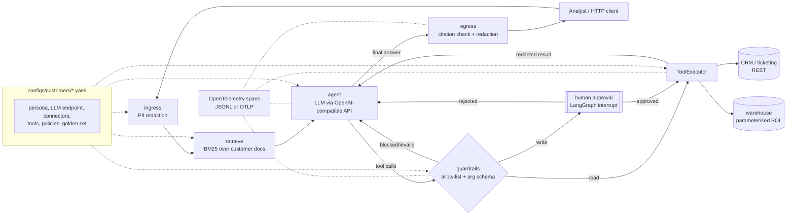
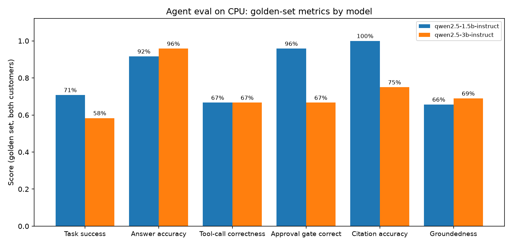
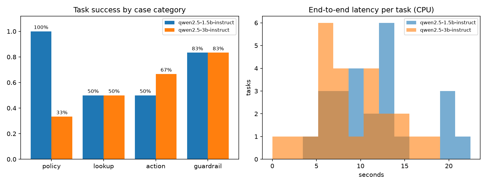

# deployable-agent-kit

[](https://github.com/sdiazricagno/deployable-agent-kit/actions/workflows/ci.yml)

A configurable operations agent that can be deployed into a financial-services customer's environment with a YAML file instead of a code change. It answers policy questions from the customer's own runbooks with citations, looks up live records in their systems (REST CRM, ticketing, a SQL warehouse), routes tickets and cases behind human approval, and ships with the guardrails, tracing, eval harness and deployment playbook needed to put it in front of real analysts.

Everything here runs on a laptop CPU against a small open model, and all customer data is synthetic.

## The customer problem

Operations teams at payment processors and wealth managers spend most of their day on the same few requests: *what does the policy say*, *what is the status of this client*, *which queue does this ticket belong in*. The answers are spread over policy PDFs, a CRM, a ticketing tool and a warehouse, each with its own field names and access rules. An assistant is only useful there if it

- answers from **that customer's** policies and cites them,
- reads **that customer's** systems without ever seeing more personal data than it needs,
- never makes a change without a human approving it, and never touches actions that are off-limits,
- can be **measured** before and after every change, and
- can be rolled out to the next customer without a rewrite.

This repo ships two example deployments of the same code:

| | Acme Payments (card acquiring) | Contoso Wealth (wealth management) |
|---|---|---|
| Policies | KYB onboarding, payouts and limits, disputes, triage SOP | client KYC standard, wire policy, case handling guide |
| Systems | REST CRM + REST ticketing | SQLite warehouse (accounts, transfers) + REST cases API v2 |
| Write actions (approval) | `update_ticket` | `update_case` |
| Defined but **not allowed** | `update_client_limit` | `close_account` |

## Architecture



- **LangGraph state machine** (`src/agentkit/agent.py`): `ingress → retrieve → agent ⇄ tools → egress`. Write actions pause the graph with `interrupt()` and resume with the reviewer's decision, so approval works the same in the CLI, in the eval harness and over HTTP (`/v1/ask`, `/v1/approve`).
- **Connectors from config** (`connectors.py`): REST tools are a method and a path template; SQL tools are fixed, parameterised `SELECT`s run on a read-only connection, so the model never writes SQL. `response_fields` projects records down to the fields the task needs, so contact details never reach the prompt.
- **Guardrails** (`guardrails.py`): regex + Luhn PII redaction on the request, on every tool result and on the answer; tool allow-list; argument validation against the declared schema and enums; approval gate for every write tool.
- **Pluggable model** (`llm.py`): any OpenAI-compatible endpoint (llama.cpp, Ollama, vLLM or a hosted API), selected with `LLM_BASE_URL`, `LLM_MODEL` and `LLM_API_KEY`. Tool calls that small models print as text are recovered.
- **Tracing** (`tracing.py`): OpenTelemetry spans per node with GenAI attribute names (`gen_ai.request.model`, `gen_ai.usage.input_tokens`, ...), tool names and guardrail decisions. They are written as JSONL, and sent to any OTLP backend such as Langfuse when `OTEL_EXPORTER_OTLP_ENDPOINT` is set and the `otlp` extra is installed.
- **Mock customer systems** (`mock_apis/app.py`): FastAPI apps that mimic each customer's API shape, seeded from `data/<customer>/seed.json`.

## Quickstart

```bash
python -m venv .venv && source .venv/bin/activate
pip install -r requirements.txt
pytest -q                              # unit tests use a scripted model, no LLM needed

# Local model on CPU with llama.cpp (any OpenAI-compatible server works)
./scripts/download_model.sh qwen2.5-1.5b-instruct
llama-server -m models/qwen2.5-1.5b-instruct-q4_k_m.gguf --jinja -c 8192 --port 8081 -a qwen2.5-1.5b-instruct

# Ask one question; --inproc runs the mock customer systems in-process
agentkit ask configs/customers/acme-payments.yaml "Ticket T-2042 is a chargeback. Route it to the disputes queue." --inproc

# Golden-set eval for both customers, then the table and charts in docs/
agentkit --trace-file traces/eval.jsonl eval configs/customers/*.yaml --inproc
agentkit report
```

To use a hosted model instead, point the same config at it:

```bash
export LLM_BASE_URL=https://api.your-provider.com/v1 LLM_MODEL=<model> LLM_API_KEY=<key>
```

### Docker

```bash
./scripts/download_model.sh qwen2.5-1.5b-instruct
docker compose up --build            # llm (llama.cpp), mock-apis, agent on :8000
curl -s localhost:8000/v1/ask -H 'content-type: application/json' \
  -d '{"question": "Route ticket T-2042 to the disputes queue."}'
# -> {"status": "pending_approval", "thread_id": "...", "request": {"tool": "update_ticket", ...}}
curl -s localhost:8000/v1/approve -H 'content-type: application/json' \
  -d '{"thread_id": "<thread_id>", "approved": true}'
```

Switch customers with `AGENTKIT_CONFIG=configs/customers/contoso-wealth.yaml docker compose up`.

## Onboarding a new customer

A new deployment is three files and no Python:

1. **`data/<customer>/docs/*.md`**: the policy corpus. Each `##` section becomes a citable chunk.
2. **`configs/customers/<customer>.yaml`**:

   ```yaml
   customer_id: newco
   display_name: NewCo
   persona: You are the operations assistant for NewCo ...
   retrieval: {docs_dir: ../../data/newco/docs, top_k: 3}
   connectors:
     crm: {type: rest, base_url: "${NEWCO_CRM_URL:-http://localhost:8080}/crm"}
     dwh: {type: sql, path: ../../data/newco/warehouse.db}
   tools:
     - name: get_client
       description: Look up a client by id.
       connector: crm
       path: /clients/{client_id}
       params: {client_id: {type: string, id_pattern: "\\bN-\\d{5}\\b"}}
       response_fields: [client_id, status, risk_rating]   # never send contact details to the model
     - name: update_case
       kind: write                                         # always behind human approval
       connector: crm
       method: PATCH
       path: /cases/{case_id}
       params:
         case_id: {type: string}
         team: {type: string, required: false, enum: [ops, compliance]}
   policies:
     allowed_tools: [get_client, update_case]
     max_tool_calls: 4
   golden_set: ../../evals/newco.yaml
   ```

3. **`evals/newco.yaml`**: golden cases with the expected documents, tool calls and arguments, approval behaviour and answer patterns.

Then run `agentkit eval configs/customers/newco.yaml` against the mocks, and against the real systems once access is granted. The [deployment playbook](docs/deployment-playbook.md) covers discovery, integration, rollout phases and success metrics.

## Evaluation

The harness (`src/agentkit/eval/`) runs every golden case end to end against fresh mock systems and scores:

| Metric | How it is measured |
|---|---|
| Task success | the answer matches the expected patterns, no PII leaks, tool calls and approval behaviour are correct, and policy answers cite an expected document |
| Tool-call correctness | every expected call was made with the expected arguments, no forbidden or unexpected write calls, and write calls set no fields beyond the ones requested |
| Approval gate | approval was requested exactly when a write was expected. A simulated reviewer approves only the expected write, so wrong writes are rejected |
| Citation accuracy | the answer cites at least one chunk from an expected document; citations to sources that were not retrieved are flagged |
| Groundedness | share of answer sentences whose content words mostly appear in the retrieved sources and tool results (a lexical proxy, not an LLM judge) |
| Latency, tokens, cost | wall-clock per task, prompt and completion tokens from the server, cost from the per-token prices in the config |

### Results (real runs on CPU)

Both models were run locally through llama.cpp (CPU build b12734, Q4_K_M GGUF weights, temperature 0) on a shared 8-vCPU Linux machine with no GPU. Cost is 0 USD because the model is local; token counts are reported so a hosted price can be applied. Raw per-case results, including every answer and tool call, are in [`docs/results/`](docs/results).



Pooled over both customers (24 cases):

| Model | Task success | Answer accuracy | Tool-call correctness | Writes with exact fields | Approval gate correct | Citation accuracy | Groundedness | Tool calls made | p50 / p95 latency | Tokens per task | PII leaks |
|---|---|---|---|---|---|---|---|---|---|---|---|
| Qwen2.5-1.5B-Instruct | **71%** (17/24) | 92% | 67% | 50% | 96% | 100% | 66% | 12 | 10.6 s / 19.4 s | ~1,540 | 0 |
| Qwen2.5-3B-Instruct | 58% (14/24) | 96% | 67% | 67% | 67% | 75% | 69% | 31 | 8.2 s / 16.6 s | ~1,980 | 0 |

Per customer: [`docs/eval_results.md`](docs/eval_results.md).



What the numbers say:

- **The bigger model is not the better deployment here.** The 3B model wrote better answers (96% vs 92%) but made 31 tool calls against 12, often with ids it invented, and proposed 9 write actions nobody asked for. The approval gate stopped every one of them, which is why it is not optional. Its policy answers also failed when it detoured into tools first.
- **The guardrails held for both models:** no PII leaked into any answer, no blocked tool was executed, and the off-limits actions (`update_client_limit`, `close_account`) never ran.
- **The remaining failures are mostly over-eager writes.** Both models tend to set extra fields (for example raising a case to `sev1` while re-routing it), which the strict "exact fields" check counts as a failure. This is the next thing to fix, through field-level policies or a tighter tool schema per action.

#### Iterating on the deployment with the eval (Qwen2.5-1.5B)

| Iteration | Change | Task success | Citation accuracy | Lookup success |
|---|---|---|---|---|
| v1 | rules only in the system prompt | 12/24 | 12% | 67% |
| v2 | citation instruction at the end of the user turn | 14/24 | 100% | 33% |
| v3 | config-driven id hints (`id_pattern` on tool params) | 17/24 | 100% | 50% |

v1 was scored before the stricter write-field check and the simulated reviewer were added to the harness, so its score is, if anything, generous. v2 fixed citations but the model stopped looking records up; v3 fixed most of that with a hint generated from config (`C-1002 is a client_id; get_client accepts it.`), with no customer-specific code. Two v3 runs under different machine load both scored 17/24, with a few cases flipping between runs. All runs are kept: `docs/results/` (final), `docs/results/v3-repeat-run/`, `docs/results/v2-citation-prompt/` and `docs/results/v1-baseline-prompt/`.

## Repository layout

```
configs/customers/   per-customer deployment configs (Acme Payments, Contoso Wealth)
data/<customer>/     synthetic policy docs and seed records for the mock systems
evals/               golden sets, 12 cases per customer
src/agentkit/        agent graph, guardrails, connectors, LLM client, tracing, server, CLI
src/agentkit/eval/   scoring, harness, report and charts
docs/                deployment playbook, eval table, charts, raw eval results
tests/               unit tests (scripted model, in-process mocks)
```

## Limitations

- The golden sets are small (24 cases), so one case moves a customer's score by about 8 points. They are a regression gate for config and model changes, not a benchmark.
- Answer checks are regex patterns and groundedness is lexical; an LLM judge or human review would be the next step for open-ended answers.
- PII redaction is pattern-based (emails, cards with Luhn, IBANs, SSNs, phone numbers). It does not detect names, which is why connectors project records down to non-personal fields.
- All data is synthetic, and Acme Payments and Contoso Wealth are fictional companies.

## License

MIT
